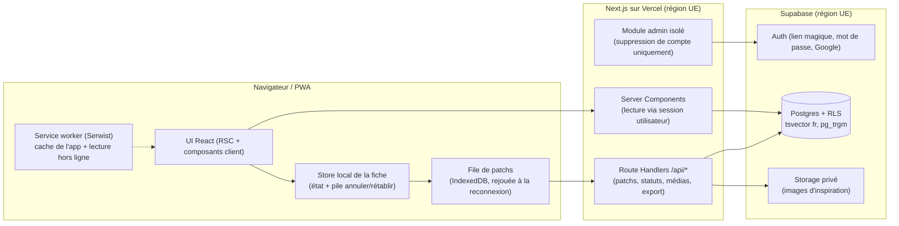

# Plan d'implémentation — Élan (nom provisoire)

> Version 0.2 · 8 novembre 2026 · statut : **validé**, phase 0 en cours
> Documents liés : [`CLAUDE.md`](../CLAUDE.md) · [`principles.md`](principles.md) · [`design-system.md`](design-system.md) · [`decisions.md`](decisions.md) · [`screens/`](screens/) · [`mockups/maquettes.html`](mockups/maquettes.html)

---

## 1. En une phrase

Une PWA mobile-first, sans IA, qui rend agréable le fait d'**écrire, décrire et qualifier une envie**, avec une sauvegarde continue qui ne perd jamais rien, une base de données déjà prête pour le partage futur, et une identité « carnet » cohérente.

Trois partis pris structurent tout le reste :

1. **L'envie est son propre brouillon.** Elle existe dès qu'on tape « Garder » (titre seul), avec un identifiant généré côté client. Chaque champ modifié ensuite est un petit _patch_ sauvegardé en continu. Il n'y a pas de bouton « Enregistrer ».
2. **La base protège, l'interface accompagne.** La sécurité repose sur la Row Level Security de Postgres (pas sur du code applicatif). L'accompagnement repose sur des textes, des exemples et des questions écrites à la main (pas sur un modèle).
3. **La forme est une fonctionnalité.** Tokens et composants existent dans Storybook avant les écrans. Chaque écran est décrit dans `docs/screens/` avant d'être codé.

---

## 2. Architecture



### 2.1 Accès aux données

- **Lecture** : Server Components avec le client `@supabase/ssr` porteur de la session de l'utilisateur. La RLS s'applique à chaque requête.
- **Écriture** : Route Handlers `PATCH /api/goals/:id`, `POST /api/goals`, etc. Zod valide chaque entrée côté serveur, puis on écrit avec le client de session (RLS toujours active).
- **Pourquoi pas de Server Actions pour la sauvegarde auto** : leurs identifiants changent à chaque déploiement, ce qui casse le rejeu d'une file hors ligne. Les Route Handlers donnent un contrat stable et versionnable. Les Server Actions restent possibles pour les formulaires simples (réglages du profil).
- **Clé `service_role`** : utilisée uniquement dans `src/server/admin/` (marqué `server-only`), pour la suppression de compte et le nettoyage du Storage. Une règle ESLint interdit d'importer ce module ailleurs.

### 2.2 Sauvegarde automatique (cœur technique)

1. Chaque champ du parcours écrit dans un store local de la fiche (Zustand, un store par envie ouverte).
2. Un _debounce_ de 700 ms produit un patch par champ : `{ goalId, field, value, baseVersion, clientMutationId }`.
3. Le patch entre dans une file persistée en IndexedDB (Dexie), puis part vers l'API. En cas de succès, l'API renvoie la nouvelle `version`.
4. **Conflits** : comme les patchs sont par champ, deux appareils qui modifient des champs différents ne se gênent pas. Si le même champ a changé ailleurs, la dernière écriture gagne et l'ancienne valeur reste dans l'historique ; un message discret le signale.
5. **Indicateur** : « Enregistré » (état normal) · « Enregistrement… » (seulement après 400 ms, pour éviter le clignotement) · « Hors ligne, gardé sur cet appareil ». Jamais de rouge, jamais de modale.
6. **Historique** : le serveur crée un instantané dans `goal_revisions` à la sortie d'une section, à « Relire & garder », ou si le dernier instantané a plus de 10 minutes. On ne crée pas un instantané par frappe.
7. **Annuler / rétablir** : pile locale à la session d'édition (bouton dans la barre du parcours, `Ctrl/Cmd+Z` hors de l'éditeur riche ; Tiptap gère sa propre pile dans la description).

### 2.3 Hors ligne minimal (phase 5, préparé dès la phase 1)

- Le service worker met en cache l'application et la dernière liste d'envies consultée.
- Création express et modification des champs texte possibles hors ligne : identifiants UUIDv7 générés côté client, donc le rejeu est idempotent.
- Pas d'envoi d'image hors ligne (message doux : « Les images pourront être ajoutées une fois reconnecté·e »).
- Pas de Background Sync (Safari ne le gère pas) : la file est vidée à chaque ouverture de l'app et au retour du réseau.

### 2.4 Structure du dépôt

```
elan/
├─ src/
│  ├─ app/                    # routes Next.js (segments en anglais)
│  │  ├─ (marketing)/         # page d'accueil publique, confidentialité, CGU
│  │  ├─ (auth)/              # sign-in, sign-up, verify, callback
│  │  ├─ (app)/               # home, goals, goals/[id], goals/[id]/edit/[section],
│  │  │                       # goals/[id]/smart/[step], me, me/settings, me/data
│  │  └─ api/                 # goals, goals/[id], media, export, account
│  ├─ components/ui/          # primitives shadcn personnalisées
│  ├─ components/             # composants produit (GoalCard, ChipGroup, StepSelector…)
│  ├─ features/goals/         # schémas Zod, complétude, phrase SMART, requêtes, patchs
│  ├─ features/offline/       # file IndexedDB, synchronisation
│  ├─ server/admin/           # seul endroit autorisé à utiliser service_role
│  ├─ lib/supabase/           # clients server / browser / middleware
│  ├─ i18n/                   # config next-intl ; messages/fr/*.json, messages/en/*.json
│  ├─ config/app.ts           # APP_NAME = "Élan" et constantes produit
│  └─ styles/tokens.css       # tokens sémantiques (clair / sombre)
├─ supabase/
│  ├─ migrations/             # SQL versionné
│  ├─ tests/                  # pgTAP : politiques RLS, contraintes
│  └─ seed.sql
├─ e2e/                       # Playwright (mobile + desktop, clair + sombre)
├─ .storybook/
└─ docs/
```

### 2.5 i18n

- `next-intl`, français par défaut, structure anglaise présente dès le départ (fichiers `en` remplis au fur et à mesure, sans bloquer).
- Langue issue du profil, puis d'un cookie, puis de `Accept-Language`. Pas de préfixe de langue dans les URL (application derrière connexion).
- Messages ICU (pluriels, genre neutre quand c'est possible : « connecté·e » seulement en dernier recours, on préfère tourner la phrase).
- ESLint `i18next/no-literal-string` sur le JSX : aucun texte en dur.
- Les catégories et valeurs système sont stockées par **clé** (`sport_health`) et traduites à l'affichage. Les catégories personnalisées stockent leur libellé.

### 2.6 Sécurité et vie privée

- Zod sur toutes les entrées serveur. Liens du texte riche limités à `http`, `https`, `mailto`.
- En-têtes : CSP avec nonce (middleware), HSTS, `X-Content-Type-Options`, `Referrer-Policy: strict-origin-when-cross-origin`, `Permissions-Policy` restrictive (pas de géolocalisation, pas de caméra), `frame-ancestors 'none'`.
- Limitation de débit sur les routes d'écriture et d'export (Upstash Ratelimit, région UE), en plus des limites natives de Supabase Auth.
- Images : compressées en WebP côté client (max 2000 px), bucket privé avec `allowed_mime_types` et `file_size_limit` (5 Mo), URL signées de courte durée.
- Sentry configuré pour **ne jamais** envoyer le contenu des envies (scrubbing des corps de requête, pas de replay de session). Plausible sans cookie.
- Hébergement UE : Supabase en région Paris ou Francfort, fonctions Vercel en `cdg1`.

---

## 3. Modèle de données

Conventions : `snake_case`, clés `uuid` (UUIDv7 générés côté client pour `goals`), `created_at` / `updated_at` partout, énumérations en `text` + `CHECK` (plus simples à faire évoluer que les enums Postgres), schémas Zod comme source de vérité côté TypeScript, types générés par `supabase gen types`.

### 3.1 Tables utilisées dès maintenant

| Table                 | Colonnes principales                                                                                                                                                                                                                                                                                                                                                                                                                                                                                                                                                                                                                                                                                  | Notes                                                                                                                                                                  |
| --------------------- | ----------------------------------------------------------------------------------------------------------------------------------------------------------------------------------------------------------------------------------------------------------------------------------------------------------------------------------------------------------------------------------------------------------------------------------------------------------------------------------------------------------------------------------------------------------------------------------------------------------------------------------------------------------------------------------------------------- | ---------------------------------------------------------------------------------------------------------------------------------------------------------------------- |
| `profiles`            | `id` (= `auth.users.id`), `display_name`, `avatar_path`, `locale`, `theme` (`system`/`light`/`dark`), `age_confirmed_at`, `privacy_accepted_at`, `onboarding_completed_at`, `first_goal_celebrated_at`                                                                                                                                                                                                                                                                                                                                                                                                                                                                                                | Créée par trigger à l'inscription. `on delete cascade` depuis `auth.users`.                                                                                            |
| `goals`               | `id`, `owner_id`, `title` (requis, 1–120), `tagline`, `emoji`, `color`, `description_doc` (jsonb ProseMirror), `description_text` (texte dérivé), `imagined_outcome`, `where_with`, `why`, `benefits`, `first_step`, `notes`, `status`, `status_changed_at`, `visibility`, `difficulty` (1–5), `preparation`, `horizon`, `target_date`, `target_precision` (`day`/`month`/`season`/`year`), `energy`, `budget_level`, `budget_min_cents`, `budget_max_cents`, `currency`, `time_estimate`, `mode`, `seasons` (text[]), `place`, `capture_mode` (`express`/`full`), `completeness_level`, `missing_sections` (text[]), `completion_dismissed_at`, `version`, `search_vector`, `deleted_at`, timestamps | `completeness_level` ∈ `sketch` / `on_track` / `well_filled`, recalculé par le serveur à chaque patch. Corbeille douce : `deleted_at`, purge après 30 jours (pg_cron). |
| `categories`          | `id`, `owner_id` (null = catégorie système), `key` (système) ou `label` (perso), `icon`, `hue`, `sort_order`, `hidden_at`                                                                                                                                                                                                                                                                                                                                                                                                                                                                                                                                                                             | L'utilisateur peut masquer une catégorie système et créer les siennes.                                                                                                 |
| `goal_categories`     | `goal_id`, `category_id`, `position`                                                                                                                                                                                                                                                                                                                                                                                                                                                                                                                                                                                                                                                                  | Multi-choix.                                                                                                                                                           |
| `tags`                | `id`, `owner_id`, `label`, `label_normalized`                                                                                                                                                                                                                                                                                                                                                                                                                                                                                                                                                                                                                                                         | Unique par `(owner_id, label_normalized)`, pour l'autocomplétion.                                                                                                      |
| `goal_tags`           | `goal_id`, `tag_id`                                                                                                                                                                                                                                                                                                                                                                                                                                                                                                                                                                                                                                                                                   |                                                                                                                                                                        |
| `goal_values`         | `goal_id`, `value_key` (système) ou `custom_label`                                                                                                                                                                                                                                                                                                                                                                                                                                                                                                                                                                                                                                                    | Liberté, apprendre, partager, se dépasser, se détendre, transmettre…                                                                                                   |
| `smart_answers`       | `goal_id` (PK), `specific`, `measurable`, `achievable`, `obstacle`, `if_then`, `relevant`, `time_bound`, `assembled_sentence`, `assembled_edited`                                                                                                                                                                                                                                                                                                                                                                                                                                                                                                                                                     | Relation 1:1. Si l'utilisateur a retouché la phrase (`assembled_edited`), on ne l'écrase plus ; on propose « Réassembler à partir de mes réponses ».                   |
| `goal_status_history` | `id`, `goal_id`, `from_status`, `to_status`, `changed_at`, `note`                                                                                                                                                                                                                                                                                                                                                                                                                                                                                                                                                                                                                                     | Rempli par trigger.                                                                                                                                                    |
| `goal_revisions`      | `id`, `goal_id`, `snapshot` (jsonb), `reason` (`section_exit`/`review`/`interval`/`restore`), `created_at`                                                                                                                                                                                                                                                                                                                                                                                                                                                                                                                                                                                            | 50 derniers instantanés conservés par envie.                                                                                                                           |
| `goal_media`          | `id`, `goal_id`, `kind` (`image`/`link`), `storage_path`, `url`, `title`, `alt_text`, `position`                                                                                                                                                                                                                                                                                                                                                                                                                                                                                                                                                                                                      | `alt_text` proposé à la saisie (accessibilité).                                                                                                                        |
| `app_flags`           | `key`, `enabled`                                                                                                                                                                                                                                                                                                                                                                                                                                                                                                                                                                                                                                                                                      | `sharing_enabled = false` pour l'instant.                                                                                                                              |

> **Pas de table `drafts`** : puisque l'envie est son propre brouillon, une table de brouillons ferait doublon. Le seul brouillon est local : le texte de la capture express avant « Garder », conservé en IndexedDB si l'app se ferme. Voir `decisions.md` (D-006).

Valeurs des énumérations :

- `status` : `idea` · `confirmed` · `preparing` · `in_progress` · `done` · `paused` · `let_go`
- `visibility` : `private` · `circle` · `community`
- `preparation` : `none` · `light` · `medium` · `heavy` · `very_heavy`
- `horizon` : `short` · `medium` · `long` · `someday`
- `energy` : `low` · `medium` · `high`
- `budget_level` : `none` · `low` · `medium` · `high`
- `time_estimate` : `minutes` · `day` · `weekend` · `several_days` · `spread`
- `mode` : `solo` · `together` · `open`
- `seasons[]` : `spring` · `summer` · `autumn` · `winter` · `weekend` · `holidays` · `when_free`

### 3.2 Tables anticipées (créées vides, RLS « tout refuser »)

`follows`, `circles`, `circle_members`, `reactions`, `comments`, `contribution_offers`, `interest_signals`, `reports`, `blocks`. Les clés étrangères vers `profiles` sont posées dès maintenant avec le comportement de suppression voulu (`cascade` pour les liens, `set null` + anonymisation pour les contenus publiés chez les autres).

### 3.3 RLS

- `goals` : `select`, `update`, `delete` si `owner_id = auth.uid()` ; `insert` si `owner_id = auth.uid()`.
- Le partage est **modélisé mais fermé** : une fonction `goal_visible_to(goal, uid)` contient déjà les branches `circle` et `community`, mais elles ne s'ouvrent que si `app_flags.sharing_enabled` est vrai. Tant que ce n'est pas le cas, une politique `WITH CHECK` refuse aussi d'enregistrer une visibilité autre que `private`.
- Tables enfants : accès si `is_goal_owner(goal_id)` (fonction `security definer`, `stable`, `search_path` fixé).
- Storage : bucket `goal-media` privé, chemin `{user_id}/{goal_id}/{uuid}.webp`, politique sur le premier segment du chemin.
- **Tests pgTAP** : un autre utilisateur ne peut ni lire, ni modifier, ni deviner l'existence d'une envie, même avec `visibility = 'community'` tant que le partage est fermé ; un utilisateur anonyme ne lit rien.

### 3.4 Recherche et index

- Configuration `fr_unaccent` (copie de `french` + dictionnaire `unaccent`) pour que « reve » trouve « rêve ».
- `search_vector` maintenu par trigger : titre (poids A), accroche et tags (B), description, pourquoi et résultat imaginé (C). Index GIN.
- `pg_trgm` sur `title` pour la recherche approximative et par préfixe.
- Index : `(owner_id, updated_at desc)`, `(owner_id, status)`, `(owner_id, horizon)`, `(owner_id, energy)`, `(owner_id, budget_level)`, `goal_categories (category_id, goal_id)`, index partiel pour « Fiches à compléter » (`completeness_level = 'sketch' and completion_dismissed_at is null and deleted_at is null`).

### 3.5 Suppression du compte et export

- **Export** : `GET /api/export` produit une archive ZIP (`fflate`) contenant `elan-export.json` (tout, y compris l'historique des statuts), un fichier Markdown par envie et le dossier `images/`.
- **Suppression** : confirmation explicite dans l'interface (taper son pseudo), puis le module admin supprime les fichiers du Storage du préfixe utilisateur et supprime l'utilisateur Auth. Tout le reste part en cascade. Écran final sobre, e-mail de confirmation.

---

## 4. Stack : ce que je garde, ce que je challenge

| Sujet                   | Proposition du brief          | Ma recommandation                                                                                                                             | Pourquoi                                                                                                                                                                                                                                                                      |
| ----------------------- | ----------------------------- | --------------------------------------------------------------------------------------------------------------------------------------------- | ----------------------------------------------------------------------------------------------------------------------------------------------------------------------------------------------------------------------------------------------------------------------------- |
| Framework               | Next.js App Router, TS strict | **Gardé** (dernière version stable au démarrage, épinglée)                                                                                    | RSC pour des lectures rapides, écosystème, Vercel.                                                                                                                                                                                                                            |
| Styles                  | Tailwind + shadcn/ui          | **Gardé** : Tailwind v4 (tokens en CSS via `@theme`), shadcn/ui réécrit à nos tokens                                                          | Les composants shadcn sont du code qu'on possède : on peut leur donner l'allure « carnet ».                                                                                                                                                                                   |
| Bottom sheets           | —                             | **vaul** (le Drawer de shadcn)                                                                                                                | Gestes natifs, accessible, déjà intégré à shadcn.                                                                                                                                                                                                                             |
| Formulaires             | react-hook-form + Zod         | **Zod gardé partout** ; react-hook-form seulement pour les formulaires classiques (auth, réglages)                                            | Le parcours n'est pas un formulaire à soumettre : un store par champ + patchs est plus simple et plus fiable que RHF pour de la sauvegarde continue.                                                                                                                          |
| Texte riche             | Tiptap                        | **Gardé**, schéma restreint (paragraphe, titre de niveau 3, listes, gras, italique, lien). Stockage JSON + texte dérivé + Markdown à l'export | Contrôle fin du schéma, bonne accessibilité, pas de HTML arbitraire stocké.                                                                                                                                                                                                   |
| Base                    | Supabase + Drizzle ou Prisma  | **Supabase, migrations SQL via la CLI Supabase, types générés, pas d'ORM**                                                                    | La sécurité repose sur la RLS. Un ORM branché en connexion directe la contourne par défaut (rôle `postgres`). Avec `supabase-js` + session utilisateur, chaque requête passe par la RLS. Les politiques, triggers et la config de recherche s'écrivent de toute façon en SQL. |
| Hors ligne              | —                             | **Serwist** (service worker) + **Dexie** (IndexedDB)                                                                                          | Successeur maintenu de next-pwa ; Dexie pour une file simple et testable.                                                                                                                                                                                                     |
| Tests                   | Vitest, Playwright, tests RLS | **Gardé** + **pgTAP** pour la RLS, `@axe-core/playwright`, Lighthouse CI                                                                      | Les tests RLS en SQL sont les plus directs.                                                                                                                                                                                                                                   |
| Storybook               | Storybook                     | **Gardé**, builder Vite (`@storybook/nextjs-vite`), addons a11y et thèmes                                                                     | Builds rapides, test des composants dans les 2 thèmes.                                                                                                                                                                                                                        |
| Gestionnaire de paquets | —                             | **pnpm**                                                                                                                                      | Rapide, strict sur les dépendances.                                                                                                                                                                                                                                           |
| Limitation de débit     | —                             | **Upstash Ratelimit** (région UE)                                                                                                             | Fonctionne en serverless sans infrastructure. Alternative : règles du pare-feu Vercel.                                                                                                                                                                                        |
| Observabilité           | Sentry, Plausible             | **Gardé**, avec scrubbing strict                                                                                                              | Aucune donnée d'envie dans les outils tiers.                                                                                                                                                                                                                                  |

---

## 5. Phases

Chaque phase se termine par une démo (preview Vercel), une mise à jour du `README`, des tests verts et ta validation.

### Phase 0 — Fondations & design system

- Dépôt, pnpm, TS strict, ESLint (dont `no-literal-string`, frontière `server/admin`), Prettier, Husky + lint-staged, commitlint.
- CI GitHub Actions : lint, types, tests unitaires, build, build Storybook, tests pgTAP sur Supabase local (Docker disponible sur les runners GitHub).
- `CLAUDE.md`, `docs/principles.md`, `docs/design-system.md` finalisé avec la direction choisie.
- `tokens.css` (clair / sombre / système), polices auto-hébergées (`next/font`), icônes Lucide.
- Composants de base dans Storybook : Button, IconButton, Chip, ChipGroup, StepSelector, IconRadioCard, Field (libellé + aide + exemple), HelpDrawer, Sheet, Toast, SaveIndicator, CompletenessMeter, GoalCard, CategoryPill, StatusPill, BottomNav, SideNav, EmptyState, Skeleton.
- i18n (`next-intl`) branchée, fichiers `fr` et `en`.
- PWA de base (manifest, icônes, couleur de thème).
- Schéma complet + RLS + tests pgTAP + seed des catégories et valeurs.
- **Livrable** : Storybook publié, app « squelette » déployée, tests RLS verts.

### Phase 1 — Capture

- Inscription / connexion (lien magique, mot de passe, Google), vérification e-mail, déclaration 15 ans et plus, acceptation de la politique de confidentialité.
- Onboarding en 3 écrans (passable à tout moment).
- Accueil, capture express (sheet + raccourci `N`), message de première envie, proposition « Compléter la fiche maintenant ? ».
- API de patch + file de patchs (en ligne d'abord, abstraction prête pour le hors ligne), indicateur « Enregistré ».
- Liste simple et détail minimal.
- **Critère** : garder une envie en moins de 10 s sur mobile (test E2E chronométré).

### Phase 2 — Fiche complète

- Parcours guidé, sections 1, 2, 3, 6, 7 (Nommer, Décrire, Pourquoi, Premières pistes, Relire & garder). Une section par écran sur mobile, colonne + sommaire collant + aperçu en direct sur desktop.
- Éditeur Tiptap, questions de relance en chips, images d'inspiration et liens.
- Aides contextuelles (tiroir « ? » avec exemple avant / après) pour chaque champ.
- Complétude qualitative, annuler / rétablir, historique consultable et restauration.

### Phase 3 — Qualification & SMART

- Section 5 (Qualifier) : tous les critères avec leurs contrôles visuels.
- Assistant SMART en 5 écrans, phrase assemblée (gabarits i18n, sans IA), repère de clarté.
- Changement de statut libre, historique des statuts, « Lâché consciemment » avec un mot optionnel.
- Catégories personnalisées, tags avec autocomplétion.

### Phase 4 — Consulter & retrouver

- Recherche plein texte (`/`), filtres combinables en bottom sheet, filtres rapides (« Ce week-end », « Peu d'énergie », « Sans budget », « Facile à lancer »), tris, regroupements.
- Master-detail sur desktop, raccourcis clavier.
- Zone « Fiches à compléter » complète, avec « Ne plus me le proposer pour cette envie ».

### Phase 5 — Finitions

- Export ZIP et suppression de compte.
- Hors ligne minimal (lecture + file de patchs rejouée).
- Audit d'accessibilité (clavier, VoiceOver, TalkBack, zoom 200 %), Lighthouse ≥ 90, budgets de performance en CI.
- Tests visuels de non-régression (mobile / desktop × clair / sombre).
- Passage « ton » sur tous les textes, pages légales, politique de confidentialité.

État (8 novembre 2026) : export, suppression, hors ligne minimal (lecture des pages vues + captures rejouées, D-056), budgets Lighthouse en CI (D-058), audit axe automatique sur chaque test E2E, passage « ton » des messages : faits. Restent à faire avec des personnes et des appareils réels : VoiceOver, TalkBack, zoom 200 %, et la file de patchs hors ligne pour l'édition complète.

---

## 6. Risques et parades

| Risque                                                                         | Impact                | Parade                                                                                                                                                                          |
| ------------------------------------------------------------------------------ | --------------------- | ------------------------------------------------------------------------------------------------------------------------------------------------------------------------------- |
| Sauvegarde auto + hors ligne : perte ou écrasement de saisie                   | Élevé (critère n° 2)  | Patchs par champ, UUID client, `clientMutationId` idempotent, historique serveur, tests unitaires de la file + E2E « coupure réseau en pleine saisie ».                         |
| Contournement de la RLS par la clé `service_role`                              | Élevé                 | Module admin isolé, règle ESLint, tests pgTAP, revue sécurité à chaque phase.                                                                                                   |
| Éditeur riche capricieux sur iOS (clavier, sélection)                          | Moyen                 | Schéma minimal, tests sur vrais appareils (Safari iOS, Chrome Android) dès la phase 2, repli sur zone de texte simple si besoin.                                                |
| Limites PWA sur iOS (stockage évincé après inactivité, pas de Background Sync) | Moyen                 | Le serveur reste la source de vérité, la file est vidée à chaque ouverture, message doux s'il reste des modifications non envoyées.                                             |
| Le parcours complet devient un « mur de champs »                               | Élevé (anti-objectif) | Une idée par écran, divulgation progressive, tests avec 5 personnes à la fin de la phase 2.                                                                                     |
| Poids des polices (2 familles variables)                                       | Moyen (LCP)           | Sous-ensemble latin, seules les graisses utilisées, préchargement de la police d'interface uniquement.                                                                          |
| Tests visuels instables                                                        | Faible                | Polices locales, animations coupées, dates figées, exécution dans l'image Docker Playwright officielle.                                                                         |
| Données sensibles (aspirations, parfois santé)                                 | Élevé (RGPD)          | Hébergement UE, minimisation, rien dans les logs ni l'analytics, registre des traitements, DPA Supabase et Vercel.                                                              |
| Docker indisponible dans mon environnement de travail actuel                   | Moyen (dev)           | Migrations et tests RLS vérifiés localement sur un Postgres 16 avec un schéma `auth` simulé, puis en CI avec la vraie pile Supabase (Docker disponible sur les runners GitHub). |

---

## 7. Questions bloquantes (tranchées le 8 novembre 2026)

1. **Direction artistique** : A « Atelier » (D-029).
2. **Écrire avant de créer un compte** : oui, par session anonyme Supabase (D-030).
3. **Infrastructure** : dépôt `Templeclub/goalist` ; je prépare toute la configuration, la création des projets Supabase et Vercel suit le guide `docs/setup.md` (D-031).
